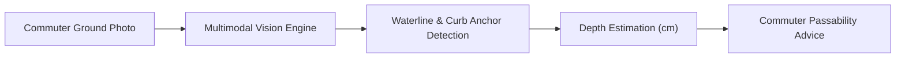
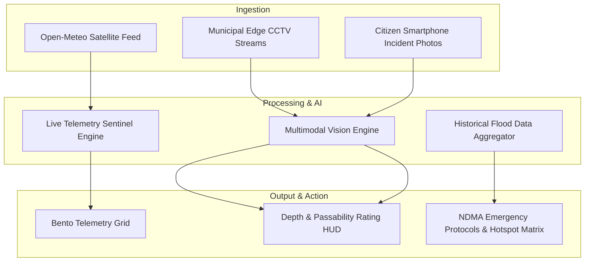

# HydroLens
### A Silent Shield. A Safe Passage.

---

## Inspiration 🌟
Imagine being caught in an unexpected monsoon downpour. Within 20 minutes, an arterial city underpass fills with 3 feet of murky storm runoff. You can't see the true depth, you can't see the open manholes beneath the surface, and your standard weather app only tells you "80% chance of rain in Delhi." For millions of daily commuters across India's metropolitan corridors, urban flash flooding isn't just an inconvenience—it's a life-threatening reality.

**HydroLens** is an innovative 🌐 AI-powered urban flood sentinel designed to protect commuters, assist emergency first responders, and empower municipal authorities by predicting localized water depth, assessing vehicular passability in real time, and delivering life-saving disaster management protocols—before disaster strikes.

---

## Try it out 🚀
[](https://share.streamlit.io/) *(Click to open the live web dashboard)*

---

## What it Does 💡

### Problem Statement
Every monsoon season, urban flash floods paralyze Indian megacities like Delhi, Mumbai, Bengaluru, and Chennai. Over **₹15,000 Crore in economic productivity is lost annually** to urban waterlogging, hundreds of vehicles suffer catastrophic engine hydro-locking, and commuters risk electrocution or drowning in submerged subways (e.g., Minto Bridge, Andheri Subway, Silk Board). Traditional meteorological forecasts provide broad regional rainfall percentages but fail to offer actionable, street-level intelligence on whether a specific road is passable for a two-wheeler, a car, or an ambulance.

---

### HydroLens’s Solution 💪

#### 1. Real-Time Multimodal Computer Vision Hazard Scanner
Commuters stranded at flooded intersections cannot gauge water depth with the naked eye.
- **Our Solution:** HydroLens utilizes **Multimodal Computer Vision** to analyze ground-level incident photos. The model detects waterlines relative to vehicle tire hubs, curbs, and road dividers, estimates depth in centimeters, and delivers instant, commuter-specific passability ratings (Pedestrian, 2-Wheeler, Car, SUV).

#### 2. Live Municipal Edge CCTV & Ground Surveillance Pipeline
Municipalities lack unified visual pipelines to monitor decentralized flood hotspots simultaneously.
- **Our Solution:** HydroLens integrates live CCTV streams and citizen dashcam/drone feeds with real-time telemetry HUD overlays, displaying water depth probes, road traction indices, and storm-drain retention rates with sub-second latency.

#### 3. Open Historical Flood Registry & Government Safety Protocols
Citizens are often unaware of historical flooding benchmarks or verified government emergency protocols.
- **Our Solution:** An open-data archive of landmark urban flood events (July 2023 Yamuna surge, 2005 Mumbai deluge, 2022 Bengaluru tech corridor overflow) paired with direct links to the **Government of India’s SACHET Early Warning Portal**, IMD Doppler radar bulletins, and National Disaster Management Authority (NDMA) protocols.

---

## Detailed Description 📝

### 1. Multimodal AI Flood & Depth Scanner
For commuters encountering a flooded underpass, guessing whether to cross can lead to submerged engines or severe accidents. HydroLens introduces an instant computer vision scanner:

#### How it Works 🛠️
- **User Side:** The user uploads a photo of a waterlogged road or underpass from their smartphone and selects their vehicle type (Pedestrian, Two-Wheeler, Standard Car, or SUV).
- **Vision Pipeline:** The image is preprocessed and analyzed by the multimodal vision model. The AI identifies visual waterlines against structural anchors (tire rims, pavement curbs, guardrails) to calculate water depth in centimeters.
- **Passability Rating:** The system cross-references the estimated depth with vehicle ground clearance thresholds to generate a safety status: `🟢 LOW HAZARD`, `🟡 MODERATE HAZARD`, or `🔴 CRITICAL IMPASSE (DO NOT ENTER)`.



---

### 2. Live Municipal Surveillance & Edge Telemetry
Authorities and emergency dispatchers need a single pane of glass to monitor vulnerable urban drainage basins.

#### How it Works 🛠️
- **Edge Video Pipeline:** Low-latency video streams from municipal CCTV cameras stationed at known flooding hotspots (e.g., Minto Bridge, Andheri Subway, Silk Board Junction) are processed and displayed.
- **Telemetry HUD:** An automated Heads-Up Display (HUD) overlays real-time sensor metrics directly onto the video feed, tracking water retention levels, road traction co-efficients, and drain sump status.
- **Custom Drone/Dashcam Ingestion:** Supports live video uploads from first responder drones and citizen dashcams.

---

### 3. Open Historical Flood Registry & NDMA Protocols
Grounds real-time analysis in decades of hydrological benchmark data:
- **Historical Flood Registry:** Chronological records of benchmark rainfall spells, peak gauge elevations, affected zones, and municipal lessons from CWC and NDMA reports.
- **SACHET & IMD Direct Gateway:** Direct, verified links to the National Disaster Management Authority's SACHET multi-hazard warning platform, IMD Mausam radar bulletins, and 24/7 NDRF emergency helplines.

---

## Screenshots & Visual Walkthrough 📸

### 1. Telemetry Sentinel & Obsidian Bento Grid
```text
+-----------------------------------------------------------------------------------+
|  [🌊 HydroLens.]                                         Location: [ Delhi ▼ ]    |
|                                                                                   |
|  ● REAL-TIME METEOROLOGICAL TELEMETRY & COMPUTER VISION SENTINEL                  |
|  A Silent Shield. A Safe Passage.                                                 |
|                                                                                   |
|  +--------------------+ +--------------------+ +--------------------+ +---------+ |
|  | 42.0 mm            | | 🔴 CRITICAL RISK   | | 28 km/h            | | <1.5s   | |
|  | Expected Rain (85%)| | Threat: Delhi      | | Wind & Gusts 45km/h| | AI Delay| |
|  +--------------------+ +--------------------+ +--------------------+ +---------+ |
+-----------------------------------------------------------------------------------+
```

### 2. Live Edge Surveillance & CCTV Video Telemetry
```text
+-----------------------------------------------------------------------------------+
|  [📊 Telemetry] [📹 Surveillance] [📸 AI Scanner] [📜 History] [🛡️ Safety] [🗺️ Map] |
|                                                                                   |
|  Corridor: Minto Bridge Underpass                  ● LIVE EDGE FEED (DEL-COR-402)  |
|  Feed Mode: [📡 Municipal CCTV Stream ▼]          [ ▶ Video Stream Active ]       |
|                                                                                   |
|  [TELEMETRY HUD] DEPTH PROBE: ~24 CM | ROAD TRACTION: 42% | RETENTION: SLOW       |
+-----------------------------------------------------------------------------------+
```

### 3. Multimodal Computer Vision Hazard Assessment
```text
+-----------------------------------------------------------------------------------+
|  [ Uploaded Flood Photo ]  --->  Estimated Water Depth: ~38 cm                    |
|  Commuter: 🛵 Two-Wheeler        Passability Status: 🔴 CRITICAL IMPASSE          |
|                                  Recommendation: Engine stall & hydro-lock risk.  |
|                                  Action: Seek designated municipal detour!        |
+-----------------------------------------------------------------------------------+
```

---

## What Sets HydroLens Apart 🌠
- **Hyper-Local & Commuter-Centric:** Moves beyond generic weather forecasts to provide street-level water depth and vehicle-specific clearance intelligence.
- **Zero-Friction Computer Vision:** Requires no special hardware—works directly from smartphone photos and existing municipal CCTV cameras.
- **Framer-Inspired Dark Obsidian UI:** Engineered with frosted glassmorphic bento grids, glowing status indicators, and clean navigation designed for emergency field visibility.
- **Verified Official Portals:** Integrates directly with official Government of India disaster infrastructure (SACHET, IMD, NDMA).

---

## Technical Details 🛠️

| Module / Component | Technology | Description |
| :--- | :--- | :--- |
| **Frontend UI** | Streamlit (Python 3), HTML5/CSS3 | Obsidian dark glassmorphism dashboard inspired by Framer design |
| **Multimodal Vision AI** | Computer Vision & Multimodal LLMs | Analyzes ground photos for waterline detection and depth estimation |
| **Meteorological Telemetry** | Open-Meteo REST API | Real-time precipitation sum, wind gusts, temperature, and AQI |
| **Edge Video Streamer** | HTML5 Video & Cloud CDN | Live CCTV video streaming with real-time telemetry HUD overlay |
| **Hydrological Archives** | Open Data (CWC, IMD, NDMA, SDMA) | Historical benchmark flood database across 9 major Indian cities |
| **Architecture** | Python Virtual Environment | Modular, lightweight, zero-dependency deployment |

---

## Architecture Flow 🏗️



---

## How AI is Used Throughout the Project 🤖

### 1. Waterline Segmentation & Depth Estimation 📏
The AI vision model inspects uploaded incident images to locate boundaries where water meets solid surfaces (car tires, sidewalks, lamp posts). By referencing known physical dimensions (e.g., standard sedan wheel radius ~30 cm), the model estimates depth in centimeters without physical ultrasonic sensors.

### 2. Commuter Passability Scoring 🚗
The system evaluates the estimated depth against vehicle mechanical clearance parameters:
- **Pedestrian:** $> 15\text{ cm}$ = Slip/manhole hazard warning.
- **Two-Wheeler:** $> 20\text{ cm}$ = High risk of exhaust silencer flooding and engine stall.
- **Standard Car:** $> 35\text{ cm}$ = High risk of air-intake hydro-locking and floating.
- **High-Clearance SUV:** $> 50\text{ cm}$ = Severe impasse warning.

### 3. Automated City Risk Indexing 🔴
Real-time weather telemetry is continuously analyzed to assign citywide risk states (`LOW`, `MODERATE`, `HIGH`, `CRITICAL`) based on 24-hour precipitation accumulation and peak wind gusts.

---

## How to Set It Up Locally 💻

### Prerequisites
- Python 3.10+ installed on Windows / macOS / Linux
- Git

### Installation Steps

1. **Clone the Repository:**
   ```bash
   git clone https://github.com/your-username/hydrolens.git
   cd hydrolens
   ```

2. **Create and Activate a Virtual Environment:**
   ```bash
   # Windows (PowerShell)
   python -m venv venv
   .\venv\Scripts\Activate

   # macOS / Linux
   python3 -m venv venv
   source venv/bin/activate
   ```

3. **Install Dependencies:**
   ```bash
   pip install -r requirements.txt
   ```

4. **Launch the Application:**
   ```bash
   streamlit run app.py
   ```

5. Open your browser and navigate to:
   👉 `http://localhost:8501`

---

## License 📄
This project is licensed under the MIT License — see the [LICENSE](LICENSE) file for details.
